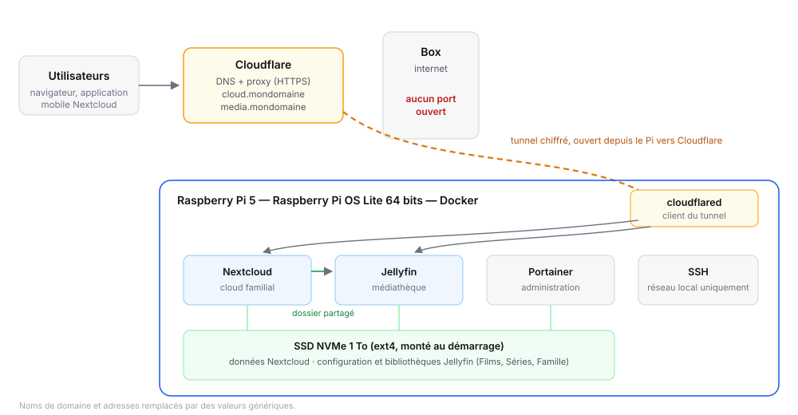

# PiCloud — serveur auto-hébergé sur Raspberry Pi 5

Un cloud familial (Nextcloud) et une médiathèque (Jellyfin) hébergés à la maison sur un Raspberry Pi 5, accessibles depuis internet sur un nom de domaine personnel **sans ouvrir aucun port** sur la box, grâce à un tunnel Cloudflare.

Projet personnel, en service depuis l'été 2025.



---

## Matériel

| Élément | Détail |
|---|---|
| Ordinateur | Raspberry Pi 5, 4 Go de RAM |
| Stockage | SSD NVMe 1 To, ext4, monté au démarrage |
| Système | Raspberry Pi OS Lite 64 bits |
| Administration | SSH en local, Portainer |

## Services

| Service | Rôle | Port local |
|---|---|---|
| Nextcloud | Cloud familial : comptes, synchronisation, dossier partagé | 8080 |
| Jellyfin | Médiathèque vidéo | 8096 |
| Portainer | Administration des conteneurs | 9000 |
| cloudflared | Client du tunnel Cloudflare | — |

Nextcloud et Jellyfin partagent un même dossier : une vidéo déposée dans Nextcloud apparaît dans Jellyfin.

## Pourquoi un tunnel Cloudflare

- **Aucun port ouvert** sur la box : c'est le Pi qui ouvre une connexion sortante vers Cloudflare.
- **L'adresse IP du domicile n'est pas exposée.**
- **HTTPS automatique** sur chaque sous-domaine, géré par Cloudflare.
- Quand le Pi est éteint, le domaine affiche une **erreur 502** : Cloudflare répond, mais ne trouve plus le serveur.

## Démarrage rapide

```bash
git clone https://github.com/P0770/picloud.git
cd picloud
cp .env.example .env     # puis remplir les valeurs
docker compose up -d
```

Le détail (SSD, Docker, tunnel, configuration de Nextcloud) est dans [`docs/installation.md`](docs/installation.md), et les problèmes rencontrés dans [`docs/depannage.md`](docs/depannage.md).

> Le serveur a d'abord été monté avec des commandes `docker run` séparées. Le fichier `docker-compose.yml` est reconstitué à partir de ces commandes pour rendre l'installation reproductible et versionnable.

## Sécurité

- Aucun secret dans ce dépôt : domaine, mots de passe et jeton du tunnel sont dans `.env`, exclu par `.gitignore`.
- Les interfaces d'administration ne doivent pas être publiées sans protection (Cloudflare Access ou accès local uniquement).

## Prochaines étapes

- [ ] Sauvegardes automatiques vers un NAS (aujourd'hui, toutes les données reposent sur un seul SSD)
- [ ] Cloudflare Access devant les interfaces d'administration
- [ ] Overleaf Community Edition pour partager des projets LaTeX

## Licence

MIT, voir [`LICENSE`](LICENSE).

---

Portfolio de Mattéo Pozzo di Borgo : [p0770.github.io](https://p0770.github.io/projects/serveur-raspberry)
